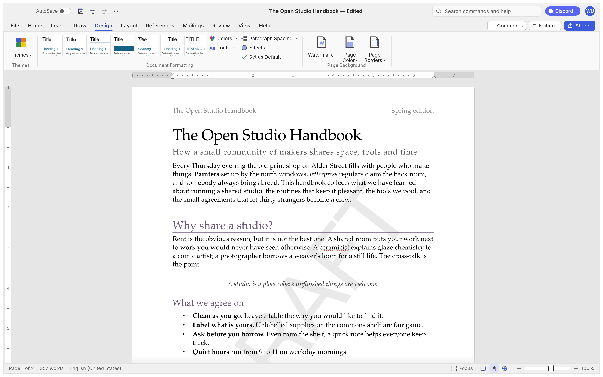
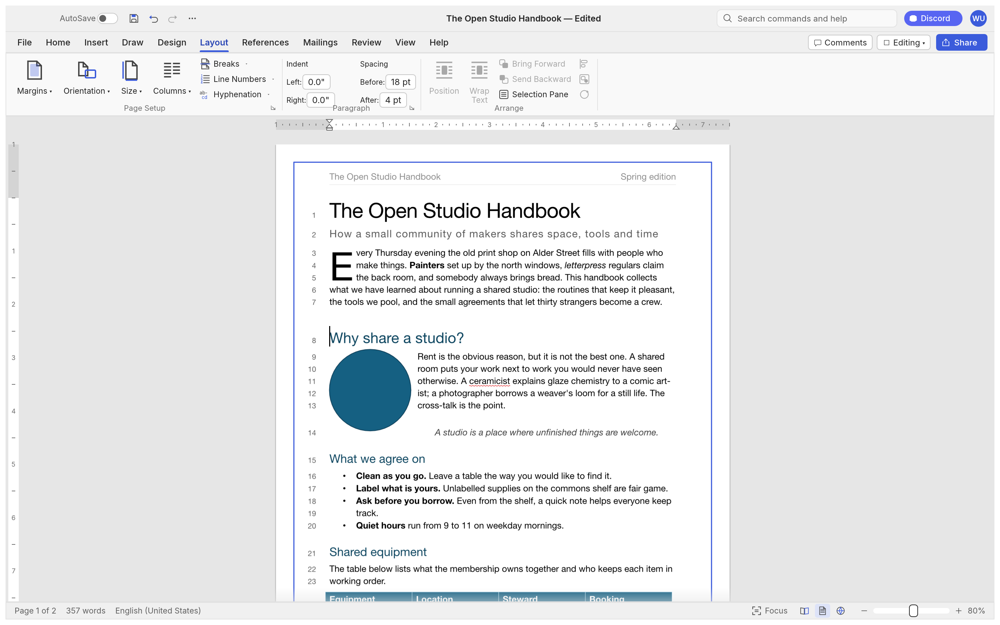
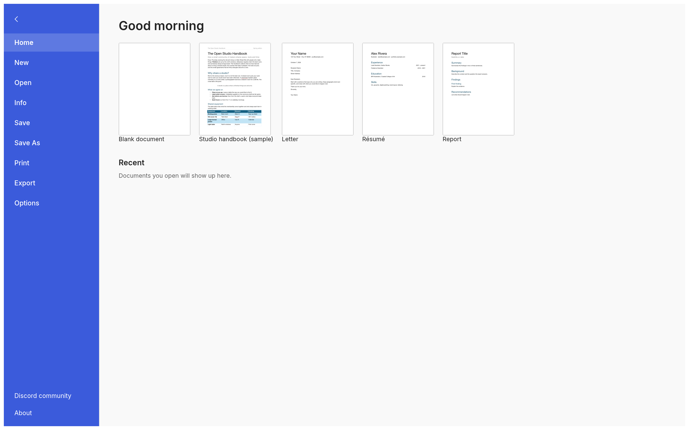

# WordCraft Collab

**A Word-style word processor in Rust that runs in the browser, with real-time co-editing.**

Several people can edit the same document at once: each person's typing appears instantly on
their own screen, everyone else's within a network round trip, and the document saves itself.
Embed it in any website with the companion package
[wordcraft-embed](https://github.com/hossamTahaHussein/wordcraft-embed), which includes the
co-editing relay server.

This project is a modified version of [WordCraft](https://github.com/storytold/wordcraft) by the
ArtCraft team. It is independent: not made, sponsored or endorsed by the ArtCraft team.

## Co-editing

| | |
|---|---|
| How it syncs | Every edit is a WordCraft command. Each browser applies its own edits at once; a small relay server puts everyone's edits in one order, and every copy replays them and re-applies its unconfirmed ones on top. |
| Code | `crates/collab` (replicas, rebasing, position mapping, protocol), `crates/engine/src/outbox.rs` and `run_ctx.rs` (recording edits, replaying them identically), `apps/wordcraft-web/src/collab_link.rs` (browser bridge) |
| Relay and SDK | [wordcraft-embed](https://github.com/hossamTahaHussein/wordcraft-embed) (`relay/`, `src/wordcraft-embed.js`) |
| Tested | Randomised multi-user convergence tests, unit tests, and end-to-end tests with three browsers and a relay restart |
| Not yet | Other people's cursors and a presence list, undo while co-editing, comment-only and view-only roles, version history |

Build the browser app with co-editing: `cd apps/wordcraft-web && trunk build --release`
(output in `dist/web`), then serve it with wordcraft-embed's demo (`EDITOR_DIR=…/dist/web npm start`).

## A tour

Every screenshot below is WordCraft itself, rendered offscreen by its own UI test harness
(`cargo run -p wordcraft-ui-egui --example ui_shot`).

<table>
<tr>
<td width="50%" valign="top"><p align="center"><sub><b>Review.</b> Track changes, comment balloons in the margin, accept and reject, spelling and grammar as you type.</sub></p></td>
<td width="50%" valign="top"><p align="center"><sub><b>References.</b> Tables of contents, footnotes, citations in APA, MLA, Chicago or IEEE, index and captions.</sub></p></td>
</tr>
<tr>
<td width="50%" valign="top"><p align="center"><sub><b>Design.</b> Themes, style sets, paragraph spacing, watermarks, page colour and borders.</sub></p></td>
<td width="50%" valign="top"><p align="center"><sub><b>Dark mode</b> with formatting marks, and the Insert tab: tables, pictures, shapes, links, headers, footers, fields and symbols.</sub></p></td>
</tr>
<tr>
<td colspan="2"><p align="center"><sub><b>Layout.</b> Drop caps, text wrapping around pictures and shapes, automatic hyphenation, line numbers and page borders.</sub></p></td>
</tr>
<tr>
<td colspan="2"><p align="center"><sub><b>File.</b> Start from a template, open recent documents, edit properties, export to PDF and other formats.</sub></p></td>
</tr>
</table>

## What works today

| Area | Highlights |
|---|---|
| **Writing** | Fast typing with IME, smart quotes, AutoCorrect, list autoformat (`* `, `1. `), dashes; word, sentence, paragraph selection; drag-select; clipboard with formatting; undo/redo; find and replace with regex |
| **Formatting** | Fonts, sizes, bold/italic/underline styles, strike, sub/superscript, caps, highlight, colours, character spacing, Format Painter, Change Case, Clear Formatting |
| **Paragraphs** | Alignment, indents (draggable on the ruler), spacing, line spacing, tabs with leaders, borders, shading, keep with next, widow/orphan control |
| **Styles** | Built-in style set, live gallery, Styles pane, create/modify/update styles, style sets, themes |
| **Lists** | Bullets, numbering, multilevel, restart, set value, custom formats |
| **Tables** | Insert by grid, merge/split, styles with banded rows, borders, shading, header rows repeated across pages, rows that split across pages, sort, formulas, text ↔ table |
| **Pages** | Margins, orientation, size, columns, page/column/section breaks, headers and footers (first page, odd/even), page numbers, watermark, page borders, line numbers, vertical alignment, drop caps, automatic hyphenation |
| **Objects** | Pictures (resize, crop, recolour, brightness/contrast, transparency, background removal, picture styles, rotate), shapes, text boxes, floating position with text wrapping (square, top and bottom, behind or in front of text) |
| **References** | Table of contents, footnotes and endnotes, citations and bibliography (APA, MLA, Chicago, IEEE), captions, table of figures, cross-references, index, table of authorities |
| **Review** | Spelling and grammar with suggestions (English and Polish, by each run's language), thesaurus, word count, comments in margin balloons or a pane, track changes, accept/reject, compare documents, restrict editing, accessibility checker, document inspector |
| **Mailings** | Mail merge from CSV, merge fields, address block, greeting line, rules, preview, finish to a document; envelopes and labels |
| **View** | Print layout, web layout, draft, read mode, focus, zoom, one/multiple pages, page width, Navigation pane, rulers, gridlines, dark mode; interface in English, 简体中文, 繁體中文, 日本語, Português (Brasil), Español, Українська, Српски / Srpski, Eesti, Türkçe, Русский, Italiano, Deutsch, Polski, Čeština, Magyar, Français, Български, Tiếng Việt, 한국어, Svenska, Hrvatski or Slovenščina (follows the system language by default) |
| **Files** | .docx read/write, legacy 97-2003 .doc import, PDF export, .odt, .rtf, .html, .md, .tex, .txt import/export, page images |

The honest picture, area by area, is in [ROADMAP.md](ROADMAP.md), the
[parity assessment](docs/target-app-parity.md) and the generated
[feature checklist](docs/parity-checklist.md).

## Quick start

```sh
git clone https://github.com/storytold/wordcraft
cd wordcraft
cargo run --release -p wordcraft -- --sample        # the desktop app with the sample document
cargo run --release -p wordcraft -- report.docx     # open a document
```

Command line:

```sh
wordcraft-cli convert report.docx report.pdf        # docx, pdf, odt, rtf, html, md, tex, txt, png
wordcraft-cli text report.docx                      # plain text
wordcraft-cli inspect report.docx                   # structure as JSON
wordcraft-cli run --template sample \
  --cmd 'select.text={"text":"Membership"}' --cmd format.bold --save out.docx
wordcraft-cli run --script job.json                 # the same from a file: commands, then save to docx and pdf
```

Web: `cd apps/wordcraft-web && trunk serve`, then open <http://127.0.0.1:8771/?sample>.

## For agents: CLI and MCP

WordCraft was designed to be driven by people *and* by AI agents.

```sh
claude mcp add wordcraft -- wordcraft-cli mcp                  # headless documents
# confine the agent to folders: wordcraft-cli mcp --automation-read-root DIR --automation-write-root DIR
wordcraft --control 7981 &                                     # or drive the running app…
claude mcp add wordcraft-app -- wordcraft-cli mcp --connect 127.0.0.1:7981
```

Tools include `list_commands`, `execute`, `batch`, `type_text`, `select_text`, `inspect_document`,
`render_page`, `save_document`, and, with a running app, `screenshot`, `click` and `key`. Agents
can check their work through `inspect_document` without screenshots. See [docs/mcp.md](docs/mcp.md)
and the [control protocol](docs/control-protocol.md). Macros record any sequence of commands and
play it back (`tools.recordMacro`, `tools.macros`).

## Logs

The desktop app writes its log records to standard error and to `logs/wordcraft.log` next to its
preferences: on Linux `$XDG_CONFIG_HOME/wordcraft/logs/` (by default `~/.config/wordcraft/logs/`),
on macOS `~/Library/Application Support/WordCraft/logs/`, on Windows `%APPDATA%\WordCraft\logs\`.
A start from a desktop menu or the Dock has no terminal, so this file is what to attach to a bug
report: unreadable parts of a .docx, pictures or fonts a PDF export had to leave out and panics the
command guard recovered from land there. Each launch moves the previous log to `wordcraft.1.log`
(and that one to `wordcraft.2.log`), so the log of a run that crashed survives the next start; a
log stops growing at 16 MiB. `--version` writes no file, and runs with `WORDCRAFT_NO_PREFS` (agents'
test runs) log to standard error only. Document text is never logged; a panic message leaves out
the text it quotes.

By default WordCraft's own crates log at `info` and everything else at `warn`. `RUST_LOG` replaces
that with env_logger-style directives, for example `RUST_LOG=debug`,
`RUST_LOG=warn,wordcraft_docx=trace` or `RUST_LOG=info,wgpu_core=warn`; a directive ending in `*`
covers every target starting with it (`wordcraft*=debug`). The logger is
`apps/wordcraft/src/logging.rs`.

## Architecture

| Layer | Crate | Job |
|---|---|---|
| L0 | `wordcraft-geom` | units and measurements |
| L1 | `wordcraft-doc`, `wordcraft-fonts`, `wordcraft-proof` | document model and editing; fonts and shaping; spelling, grammar, hyphenation |
| L2 | `wordcraft-layout`, `wordcraft-docx`, `wordcraft-formats` | line breaking, pagination, tables, notes, hit testing; OOXML; ODT/RTF/HTML/Markdown/TXT |
| L3 | `wordcraft-render`, `wordcraft-pdf` | rasteriser (vello_cpu); PDF ([craft-pdf](docs/shared-pdf.md), Krilla) |
| L4 | `wordcraft-engine` | session, undo, 422 commands, document feature catalog |
| L5 | `wordcraft-mcp` | MCP server |
| L6 | `wordcraft-ui-egui` | the word processor front end (swappable) |
| apps | `wordcraft`, `wordcraft-cli`, `wordcraft-web` | desktop, command line, browser |

`cargo xtask ci` runs formatting, clippy, ~800 tests, the asset-attribution check, the layering
check and the wasm build. Contributor guidelines: [CONTRIBUTING.md](CONTRIBUTING.md).

## License and credits

Dual-licensed under [MIT](LICENSE-MIT) or [Apache-2.0](LICENSE-APACHE), at your option, like
WordCraft. Required notices are in [NOTICE](NOTICE); bundled fonts, icons and other assets keep
their own open licenses, listed in [ATTRIBUTION.md](ATTRIBUTION.md).

Based on WordCraft, Copyright (c) 2026 ArtCraft Team and the WordCraft contributors. The ArtCraft
name and logos are trademarks of the ArtCraft Team and are not used in this project.

<sub>Microsoft and Microsoft Word are trademarks of the Microsoft group of companies. This project
is not affiliated with, sponsored by or endorsed by Microsoft Corporation.</sub>
